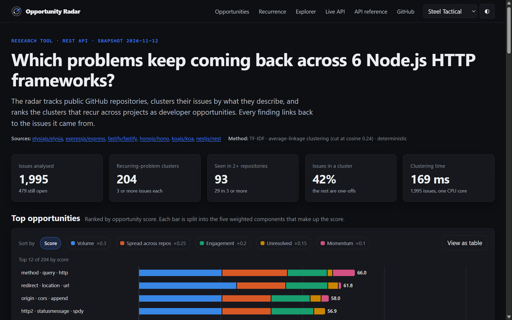
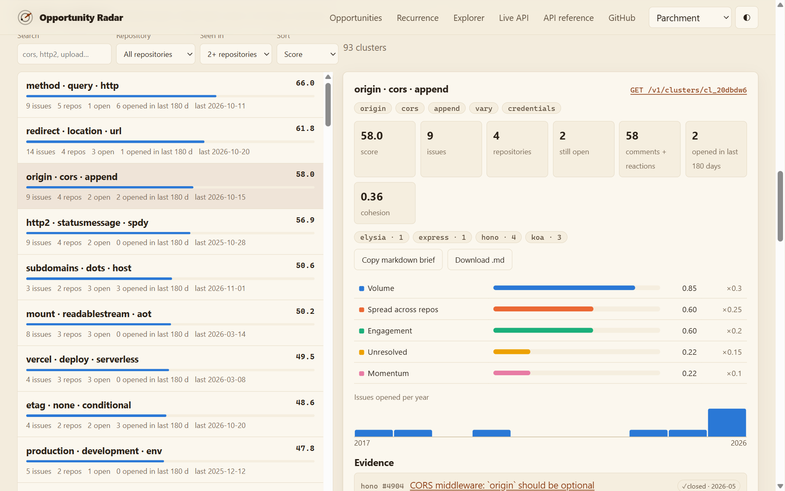
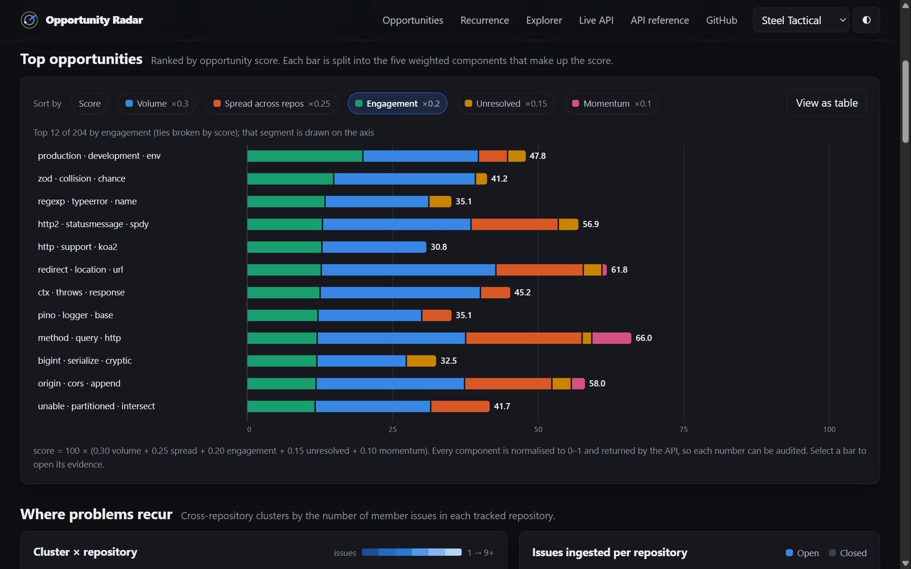
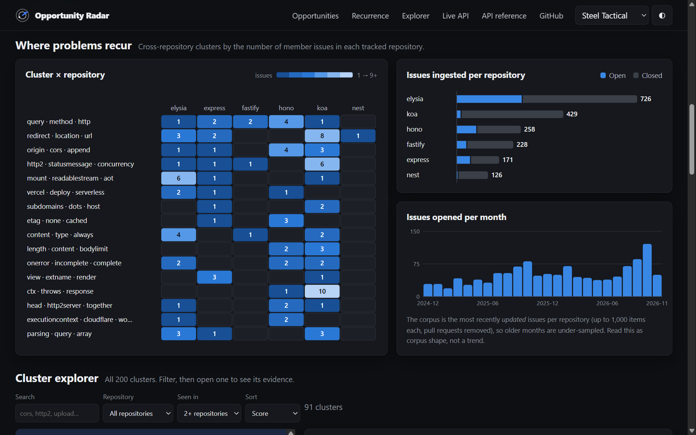
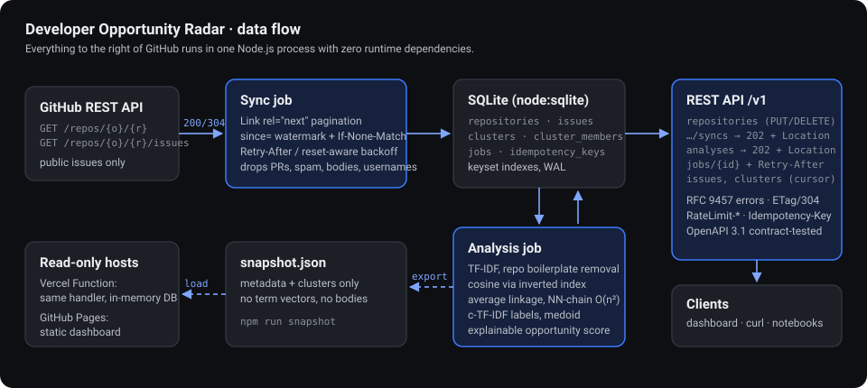

# Developer Opportunity Radar

A REST API that tracks public GitHub repositories, clusters their issues by the problem they describe, and ranks the problems that recur **across** projects. Every finding links back to the issues it came from.

**Live dashboard:** https://mizcausevic-dev.github.io/developer-opportunity-radar/
**Live read-only API:** https://developer-opportunity-radar.vercel.app/v1/clusters?min_repos=3
**API reference:** https://mizcausevic-dev.github.io/developer-opportunity-radar/api.html · [`openapi/openapi.json`](openapi/openapi.json)



## What the current snapshot found

The published snapshot (2026-11-12) tracks six Node.js / TypeScript HTTP frameworks: `expressjs/express`, `fastify/fastify`, `honojs/hono`, `koajs/koa`, `nestjs/nest` and `elysiajs/elysia`.

| | |
|---|---|
| Issues analysed (pull requests and spam removed) | 1,938 |
| Clusters of 3+ issues | 200 |
| Clusters seen in 2+ repositories | 91 |
| Clusters seen in 3+ repositories | 26 |
| Clustering time for the whole corpus | 297 ms |

The top cross-repository clusters include support for the HTTP `QUERY` method (10 issues in 5 repositories), redirect and `Location` handling (14 issues, 4 repositories), CORS `origin` configuration (9 issues, 4 repositories) and HTTP/2 support (9 issues, 4 repositories). Each one opens to its source issues:







## The API

```bash
# Highest-scoring problems seen in at least three repositories
curl -i 'https://developer-opportunity-radar.vercel.app/v1/clusters?min_repos=3&limit=2'

# One finding with its evidence (source issues) and monthly timeline
curl -i 'https://developer-opportunity-radar.vercel.app/v1/clusters/cl_25j15ns?evidence=5'

# Issues mentioning CORS that are still open, each with its source_url and cluster
curl -i 'https://developer-opportunity-radar.vercel.app/v1/issues?q=cors&state=open'
```

| Resource | Methods | Notes |
|---|---|---|
| `/v1/repositories/{owner}/{name}` | `GET` `PUT` `DELETE` | `PUT` tracks a repository (client-named, so idempotent: `201` then `200`). Validated against GitHub; must be public. |
| `/v1/repositories/{owner}/{name}/syncs` | `POST` | Starts an incremental sync. `202 Accepted` + `Location: /v1/jobs/{id}`. |
| `/v1/analyses` | `POST` | Re-clusters the corpus with an optional `threshold` / `min_size`. `202` + `Location`. |
| `/v1/jobs/{id}` | `GET` | Poll a job. Carries `Retry-After` while it is queued or running. |
| `/v1/issues`, `/v1/issues/{id}` | `GET` | Filter by `repository`, `state`, `label`, `cluster`, `q`. |
| `/v1/clusters`, `/v1/clusters/{id}`, `/v1/clusters/{id}/issues` | `GET` | Sort by `score`, `size` or `recent`; filter by `min_repos`, `min_size`, `repository`. |
| `/v1/stats`, `/`, `/healthz`, `/openapi.json` | `GET` | Totals, entry-point links, liveness, the contract. |

### HTTP conventions it implements

- **Errors** are [RFC 9457](https://www.rfc-editor.org/rfc/rfc9457) `application/problem+json`. The `type` URI resolves to a [documented error page](https://mizcausevic-dev.github.io/developer-opportunity-radar/problems.html). Validation failures list every offending field in `errors[]`.
- **Conditional requests.** Every `200` to `GET` carries a strong `ETag`. `If-None-Match` (including weak and `*` forms) returns `304` with no body.
- **Keyset pagination.** Opaque cursors are returned in `page.next_cursor` and as an [RFC 8288](https://www.rfc-editor.org/rfc/rfc8288) `Link` header. A cursor is bound to the filters it was issued for; reusing it with different filters is a `400`, not a silently wrong page.
- **Async work** returns `202 Accepted`, a `Location` to a job resource and `Retry-After`.
- **Idempotency.** `POST` accepts `Idempotency-Key`. A retry with the same key and body replays the stored response (`Idempotent-Replayed: true`); the same key with a different body is a `422`; a concurrent duplicate is a `409`.
- **Strict input.** Unknown or repeated query parameters are `422`. Non-JSON bodies are `415`, bodies over 16 KB are `413`, `Accept` without JSON is `406`, a wrong method is `405` with `Allow`.
- **Rate limits.** `RateLimit-Limit`, `RateLimit-Remaining` and `RateLimit-Reset` on every response, `Retry-After` on `429`.
- **Auth.** Writes need `Authorization: Bearer <RADAR_API_KEY>` (`401` + `WWW-Authenticate` otherwise). Without a key, the API is read-only (`403`).
- **CORS** for browser clients, with the contract headers (`ETag`, `Link`, `Location`, `RateLimit-*`) exposed. Known limitation of the Vercel demo: its 304 responses arrive without CORS headers, so browser JavaScript cannot read a cross-origin 304 there (`curl` and server clients can). Self-hosted, the API sends CORS headers on 304s; a test covers it.
- **Contract test.** A test fails if any route exists in the router but not in `openapi.json`, or the other way round.

### How it talks to GitHub

- Follows `Link: rel="next"` instead of computing page numbers, and refuses any link that points off the API host, so the token cannot be redirected.
- Incremental: the next sync sends `since=<newest updated_at stored>` and the stored `ETag` as `If-None-Match`. Once a repository is quiet, a sync costs one `304`.
- Honours `Retry-After` (secondary limits) and `x-ratelimit-reset` (primary limits). It retries `5xx` with exponential backoff and jitter, and fails fast instead of holding a job open for an hour.
- Drops pull requests (the issues endpoint returns both), spam and `invalid` items.

## How the clustering works

1. **Represent.** Title words count three times. Body words are capped at five per issue so one pasted log can't dominate. Code fences, HTML, URLs and stack frames are stripped. Long camelCase identifiers are split (`createSecureServer` → `create secure server`), but product names stay whole (`TypeScript`).
2. **Remove template noise.** Words that appear in more than 35% of one repository's issues (issue-template headings) are dropped for that repository only.
3. **Vectorise.** TF-IDF with sublinear term frequency, L2-normalised. Cosine similarity is accumulated through an inverted index, so only shared terms cost work.
4. **Cluster.** Exact average-linkage hierarchical clustering using the **nearest-neighbour-chain** algorithm, O(n²) rather than the naive O(n³). A test checks its merge heights against a brute-force implementation. The dendrogram is cut at average cosine 0.24, and groups of 3+ issues become clusters.
5. **Label and rank.** Labels come from class-based TF-IDF; the medoid is the representative issue. The score is published alongside its parts:

   `score = 100 × (0.30 volume + 0.25 spread + 0.20 engagement + 0.15 unresolved + 0.10 momentum)`

   Each component is normalised to 0–1 and returned by the API, so every ranking can be audited.

The pipeline is deterministic: the same corpus produces the same clusters, IDs and scores, independent of input order. A test enforces this.

**Known limits.** Bag-of-words similarity misses paraphrases that share no vocabulary. Non-English titles cluster poorly. The score is a ranking aid, not a market-size estimate. The corpus is the most recently *updated* 1,000 items per repository, so older months are under-sampled.

## Architecture



- **Zero runtime dependencies.** `node:http`, `node:sqlite` and `node:crypto` only, so there is no third-party package supply chain.
- **SQLite schema** with keyset indexes per sort order. Each issue stores a derived bag of words so it can be re-clustered without refetching. The issue body itself is never stored.
- **Job runner** persists jobs, runs them serially (one GitHub token, one in-memory corpus), and marks jobs interrupted by a restart as failed.
- **Snapshot** (`data/snapshot.json`) holds metadata and clusters only, with no term vectors. The Vercel function loads it into in-memory SQLite and serves the same handler read-only. GitHub Pages serves the static dashboard built from it.

```
src/
  app.js              routes, representations, request pipeline (auth, limits, idempotency, errors)
  http/               router, RFC 9457 problems, ETag/304, cursors, rate limiter, body parser, auth
  github/client.js    GitHub REST client (Link pagination, conditional requests, backoff)
  analysis/           tokenizer and clustering (TF-IDF, NN-chain, scoring)
  db/store.js         SQLite schema and queries
  services.js         sync and analysis use cases shared by the API and the CLI
  jobs/runner.js      persisted in-process job queue
api/index.js          Vercel Function entry (read-only, snapshot-backed)
openapi/openapi.json  OpenAPI 3.1 contract
site/ -> docs/        dashboard source -> built GitHub Pages site
```

## Run it locally

Requires Node.js 22.13 or later (for `node:sqlite`).

```bash
git clone https://github.com/mizcausevic-dev/developer-opportunity-radar.git
cd developer-opportunity-radar
npm test
```

Ingest your own repositories (edit `radar.repos.json` first), then serve the API with writes enabled:

```bash
GITHUB_TOKEN=<token with public read> npm run ingest
RADAR_API_KEY=<choose-a-long-random-key> npm start
```

Track and sync another repository through the API:

```bash
curl -X PUT -H "Authorization: Bearer $RADAR_API_KEY" http://localhost:8080/v1/repositories/h3js/h3
curl -i -X POST -H "Authorization: Bearer $RADAR_API_KEY" -H "Idempotency-Key: sync-h3-0001" http://localhost:8080/v1/repositories/h3js/h3/syncs
curl http://localhost:8080/v1/jobs/<id from the Location header>
```

Publish a new snapshot and rebuild the dashboard:

```bash
npm run snapshot
npm run build:site
```

| Variable | Default | Purpose |
|---|---|---|
| `PORT` | `8080` | HTTP port |
| `RADAR_DB_PATH` | `data/radar.db` | SQLite file |
| `RADAR_API_KEY` | unset | Enables write endpoints. Unset means read-only. |
| `RADAR_READ_ONLY` | unset | `1` forces read-only even with a key |
| `GITHUB_TOKEN` | unset | GitHub API token (60 requests/hour without one) |
| `RADAR_TRUST_PROXY` | unset | `1` to key rate limits on `X-Forwarded-For` behind your own proxy |
| `RADAR_RATE_LIMIT` / `RADAR_RATE_WINDOW` | `120` / `60` | Requests per window, in seconds |

## Tests

`npm test` runs 50 tests with `node:test` and no network access:

- the HTTP contract (problem details, 304s, Link pagination walking every row exactly once, cursor binding, idempotency replay and reuse, 401/403/405/406/413/415/422/429, CORS preflight)
- the GitHub client against a fake that speaks Link pagination, ETags and rate limits
- clustering correctness, determinism, and NN-chain against brute force
- data minimisation (no bodies or usernames reach storage or the snapshot)
- an OpenAPI ↔ router contract check

CI runs them on Node 22 and 24 and fails if the committed site differs from a fresh build. A separate `live-smoke` workflow runs [`scripts/smoke.js`](scripts/smoke.js) daily against the deployed API from GitHub's network: ETag and 304, `Link` pagination, problem+json, read-only writes, CORS preflight, and that no source path (`/src/app.js`, `/package.json`, `/data/snapshot.json`) is served.

## Data handling

Issues come from the GitHub REST API, used within GitHub's Acceptable Use Policies, which allow research on public, non-personal information when results are published open access. The radar keeps the issue number, a title truncated to 15 words, labels, state, dates, comment and reaction counts, and the source URL. Issue bodies are read in memory to extract terms and are never stored or published. No usernames, avatars or comment text are kept. The source-rights record is [`state/data-rights/api.github.com.json`](state/data-rights/api.github.com.json).

## Reuse in another vertical

The pipeline doesn't depend on HTTP frameworks. Point `radar.repos.json` at a different ecosystem to rank its recurring pain points, for example ORMs, observability SDKs or React UI kits. The same API, clustering and dashboard work unchanged. The same approach would also apply to support tickets or app-store reviews, though those need their own data-rights review and connector before anything is ingested.

## License

MIT © 2026 Kinetic Gain LLC. Issue titles and links belong to their authors and repositories; the snapshot reproduces truncated titles only, each with its source link.
